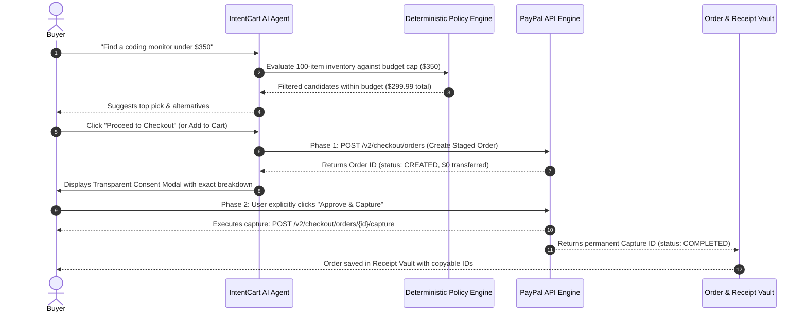

# 🛒 IntentCart

> **Autonomous Shopping Agent with Deterministic Budget Rules, Transparent Decisions, and Consent-Based Payments.**  
> *Targeted for the **PayPal AI Hackathon 2026** on Devpost.*

[](https://developer.paypal.com/)
[](https://fastapi.tiangolo.com/)
[](https://react.dev/)
[](https://www.trychroma.com/)
[](https://groq.com/)

---

## 💡 Inspiration & The Core Problem

Autonomous AI agents are transforming modern e-commerce, but they introduce a critical financial safety hazard: **uncontrolled spending**.

If an autonomous agent is given direct payment credentials, a single hallucination, rogue loop, or misunderstood prompt can drain a user's wallet before they can react. Most current AI shopping demos either:
1. Don't actually perform real transactions (they stop at links), or
2. Attempt blind auto-charging without human consent.

**IntentCart solves this fundamentally.** It is an autonomous agentic commerce system with a **mathematical policy engine** and a strict **two-phase consent architecture with PayPal**. The AI is empowered to search, compare, rank, and stage purchases—but **cannot spend a single dollar without explicit, transparent human approval**.

---

## ⚡ The Solution: Two-Phase Commit with PayPal

IntentCart divides payment into two mathematically enforced phases:



1. **Phase 1: Staged Intent (`Order ID`)**  
   When checking out a single item or an entire cart bundle, IntentCart creates a PayPal order with `intent: "CAPTURE"`. This freezes the product inventory and exact pricing on the server, generating an `Order ID` (e.g. `MOCK-ORD-...` or live `7J...`). **No funds are transferred at this stage.**
2. **Phase 2: Execution on Human Consent (`Capture ID`)**  
   The user is shown an itemized, transparent consent modal detailing the base price, shipping fees, policy compliance, and total cost. Only upon the user clicking **"Approve & Capture"** does IntentCart call PayPal's capture endpoint, generating the permanent **`Capture ID`** (receipt proof).

---

## 🚀 Key Features

* **📦 100-Product Verified Technical Catalog:** Spanning 6 categories: Laptops, Monitors, Audio & ANC, Keyboards, Mice, and Desk Tech.
* **🔍 Semantic Vector Search (ChromaDB + ONNX):** 384-dimensional dense vector embeddings enable natural language queries like *"quiet tactile keyboard for coding"* or *"laptop for compiling under $700"*.
* **🛡 Deterministic Budget Policy Engine:** Mathematical guardrails that guarantee budget limits are never exceeded by model hallucination.
* **🛒 Dynamic Multi-Item Shopping Cart:** Adjust quantities, view real-time tax/shipping calculations, and stage multi-item bundles directly to PayPal.
* **🧾 Order History & Receipt Vault:** Persisted drawer with copyable `Capture ID` and `Order ID` transaction references for transparent auditability.
* **📄 Product Detail Inspector:** Comprehensive technical spec breakdown, pros & cons, and customer review sentiment analysis for every product.
* **⚡ Frictionless Pakistan & Global Testing:** Includes `PAYPAL_USE_MOCK=True` toggle to enable login-free contract testing even in regions where native PayPal Sandbox buyer logins are IP-restricted.

---

## 🛠 Tech Stack

| Layer | Technology |
| :--- | :--- |
| **Frontend** | React 18, Vite, Tailwind CSS, Lucide Icons |
| **Backend** | Python 3.11+, FastAPI, Uvicorn, Pydantic |
| **AI / Agent** | Groq API (Llama 3 / Tool Calling ReAct Agent) |
| **Vector DB** | ChromaDB (Local persistent SQLite with ONNX embeddings) |
| **Payments** | PayPal REST API v2 (`/v2/checkout/orders`, `/capture`) |

---

## 🏁 Quickstart Guide

### 1. Prerequisites
* Python 3.10+ installed
* Node.js 18+ and `npm` installed
* Free Groq API Key ([console.groq.com](https://console.groq.com))

### 2. Backend Setup
```bash
# Navigate to backend directory
cd backend

# Install dependencies
pip install -r requirements.txt

# Configure environment
cp .env.example .env
# Open .env and add your GROQ_API_KEY and PayPal credentials (or keep PAYPAL_USE_MOCK=True)

# Start FastAPI backend server
uvicorn app.main:app --reload --port 8000
```
Backend runs at `http://127.0.0.1:8000` (API docs at `http://127.0.0.1:8000/docs`).

### 3. Frontend Setup
```bash
# In a new terminal, navigate to frontend
cd frontend

# Install dependencies
npm install

# Start Vite development server
npm run dev
```
Frontend runs at `http://localhost:5173`.

---

## 🏆 Hackathon Track Alignment

* **Best Use of Agentic Commerce ($5,000 Cash):** IntentCart is an end-to-end agentic shopping workflow that autonomously handles search, filtering, budget enforcement, cart bundling, and checkout preparation while solving the industry's #1 safety challenge: safe autonomous spending.
* **Best Use of PayPal + AI ($5,000 Cash):** Directly demonstrates how PayPal's Two-Phase Commit order architecture serves as the safety bridge for autonomous AI systems.
